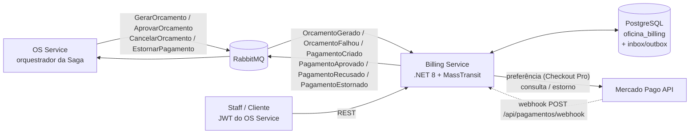

# Oficina Mecânica — Billing Service

[](https://sonarcloud.io/summary/new_code?id=konrath9_oficina-billing-service)
[](https://sonarcloud.io/summary/new_code?id=konrath9_oficina-billing-service)
[](https://sonarcloud.io/summary/new_code?id=konrath9_oficina-billing-service)
[](https://sonarcloud.io/summary/new_code?id=konrath9_oficina-billing-service)
[](https://sonarcloud.io/summary/new_code?id=konrath9_oficina-billing-service)

Microsserviço de **orçamento e pagamento** do sistema da oficina mecânica (FIAP Tech Challenge — Fase 4).
Nasceu da quebra do monólito [`konrath9/OficinaMecanica`](https://github.com/konrath9/OficinaMecanica) em três serviços:

| Serviço | Repositório | Banco | Papel na Saga |
|---|---|---|---|
| OS Service | `konrath9/OficinaMecanica` | PostgreSQL (`oficina_mecanica`) | Orquestrador (MassTransit StateMachine) |
| **Billing Service** | `konrath9/oficina-billing-service` | PostgreSQL (`oficina_billing`) | Participante: orçamento + pagamento (Mercado Pago) |
| Execution Service | `konrath9/oficina-execution-service` | MongoDB (`oficina_execucao`) | Participante: fila e execução da OS |

Contratos de mensageria: [`docs/fase4/contratos-mensageria.md`](https://github.com/konrath9/OficinaMecanica/blob/master/docs/fase4/contratos-mensageria.md)
(cópia local em [`OficinaBilling.Api/Contracts/Mensagens.cs`](OficinaBilling.Api/Contracts/Mensagens.cs), namespace `OficinaMecanica.Contracts`).

## Arquitetura



- **Projetos:** `OficinaBilling.Domain` (entidades `Orcamento` e `Pagamento` com transições protegidas),
  `OficinaBilling.Api` (controllers, consumers, EF Core, gateway de pagamento) e `OficinaBilling.Tests`.
- **Persistência:** EF Core 8 + Npgsql; migrations aplicadas automaticamente no start.
- **Mensageria:** MassTransit 8.4.1 (Apache 2.0) sobre RabbitMQ, endpoints em kebab-case,
  retry `Interval(3, 2s)` → fila `_error`. **Outbox transacional do MassTransit (EF)**: o estado e os eventos
  publicados são gravados na mesma transação; o inbox deduplica mensagens reentregues.
- **Gateway de pagamento:** `IGatewayPagamento` com duas implementações:
  - `MercadoPagoGateway` — HttpClient direto na API REST (sem SDK), usado quando `MercadoPago__AccessToken` está configurado;
  - `GatewayPagamentoFake` — padrão quando não há token: gera um link fictício, estorno sempre OK; a confirmação vem do endpoint `/simular`.
- **Observabilidade:** Serilog JSON + header `X-Correlation-Id`; OpenTelemetry (traces, métricas e logs) → New Relic via OTLP
  **somente** se `NewRelic__LicenseKey` estiver configurado (service name `oficina-billing-service`, `AddSource("MassTransit")`
  para trace distribuído). Métricas de negócio: `pagamentos.aprovados`, `pagamentos.recusados`, `pagamentos.estornados`.

## Papel na Saga

| Comando consumido | O que o Billing faz | Evento publicado |
|---|---|---|
| `GerarOrcamento` | Cria o `Orcamento` (Pendente). Valor ≤ 0 ou sem itens → falha | `OrcamentoGerado` ou `OrcamentoFalhou` |
| `AprovarOrcamento` | Orçamento → Aprovado; cria o `Pagamento` (Pendente) e a cobrança no gateway | `PagamentoCriado` (com link de checkout) |
| `CancelarOrcamento` (compensação) | Orçamento → Cancelado; pagamento pendente → Cancelado | — |
| `EstornarPagamento` (compensação) | Refund no gateway; pagamento → Estornado | `PagamentoEstornado` |

Confirmação do pagamento (fora da fila): webhook do Mercado Pago ou `POST /api/pagamentos/{id}/simular`
→ `PagamentoAprovado` ou `PagamentoRecusado`.

**Idempotência:** todos os consumers são idempotentes por `OrdemServicoId` — uma reentrega republica o mesmo evento
(mesmo `OrcamentoId`/`PagamentoId`) sem duplicar orçamento, cobrança ou estorno. Somado a isso, o inbox do MassTransit
descarta mensagens com o mesmo `MessageId`.

## Endpoints

Swagger: **`/billing/swagger`** (local: http://localhost:5001/billing/swagger). Autenticação: JWT emitido pelo OS Service
(`Jwt__Issuer=OficinaMecanicaAPI`, `Jwt__Audience=OficinaMecanicaClients`, mesma `Jwt__SecretKey`).

| Método | Rota | Acesso | Descrição |
|---|---|---|---|
| GET | `/api/orcamentos/{ordemServicoId}` | Administrador, Mecanico, Recepcionista; Cliente só se `sub` == ClienteId | Orçamento da OS com itens |
| GET | `/api/pagamentos/{ordemServicoId}` | idem | Pagamento da OS (status, link de checkout) |
| POST | `/api/pagamentos/{ordemServicoId}/simular` | Administrador, Recepcionista | Body `{ "aprovado": true, "motivo": "opcional" }` — resolve o pagamento pendente |
| POST | `/api/pagamentos/webhook` | anônimo | Notificação do Mercado Pago (`type=payment`, `data.id`) |
| GET | `/health` | anônimo | Banco + conexão com o RabbitMQ |

O webhook **nunca confia no payload**: consulta o pagamento em `GET /v1/payments/{id}` no Mercado Pago, casa pelo
`external_reference` (= `PagamentoId`) e só então aprova (`approved`) ou recusa (`rejected`/`cancelled`).
Com o gateway fake, o webhook responde 200 e ignora.

## Rodando localmente

Pré-requisitos: .NET 8 SDK e Docker.

```bash
# tudo em containers: API em http://localhost:5001, Postgres em 5434, RabbitMQ em 5672 (UI http://localhost:15672, oficina/oficina123)
docker compose up -d --build

# ou só a infraestrutura + API pelo dotnet
docker compose up -d postgres-billing rabbitmq
dotnet run --project OficinaBilling.Api   # http://localhost:5001/billing/swagger
```

Se o OS Service também estiver rodando localmente, use **o mesmo RabbitMQ** (porta 5672) para a Saga fluir entre os serviços.

Variáveis de ambiente principais:

| Variável | Padrão local | Descrição |
|---|---|---|
| `ConnectionStrings__DefaultConnection` | `Host=localhost;Port=5434;Database=oficina_billing;...` | PostgreSQL do Billing |
| `RabbitMq__Host` / `__Username` / `__Password` | `localhost` / `oficina` / `oficina123` | Broker |
| `Jwt__SecretKey` / `__Issuer` / `__Audience` | iguais ao OS Service | Validação do JWT |
| `MercadoPago__AccessToken` | vazio (gateway fake) | Access token do Mercado Pago |
| `MercadoPago__NotificationUrl` | vazio | URL pública do webhook |
| `NewRelic__LicenseKey` | vazio (sem export) | Habilita OpenTelemetry → New Relic |

## Testes e cobertura

xUnit + Moq + `MassTransit.Testing` (test harness em memória) + EF Core InMemory + `WebApplicationFactory`:
transições de domínio, cada consumer (caminho feliz, compensação e idempotência), seleção do gateway,
`MercadoPagoGateway` com `HttpMessageHandler` fake, regras de autorização dos controllers, webhook e a API completa (JWT, Swagger, health).

```bash
dotnet test /p:CollectCoverage=true /p:Threshold=80 /p:ThresholdType=line /p:CoverletOutputFormat=opencover
```

Migrations e `Program.cs` ficam fora da conta (`ExcludeByFile` no `OficinaBilling.Tests.csproj`). O build falha se a cobertura de linhas
de qualquer módulo ficar abaixo de 80%.

**Evidência (execução local, 48 testes):**

| Módulo | Linhas | Branches | Métodos |
|---|---|---|---|
| OficinaBilling.Api | 97,92% | 92,24% | 91,89% |
| OficinaBilling.Domain | 100% | 100% | 100% |
| **Total** | **98,48%** | **93,07%** | **94,73%** |

> **SonarCloud:** análise e Quality Gate em [sonarcloud.io](https://sonarcloud.io/summary/new_code?id=konrath9_oficina-billing-service).

## CI/CD

Workflow [`.github/workflows/ci-cd.yml`](.github/workflows/ci-cd.yml):

1. **`build-test`** (PR e push na `main`): restore → build → testes com gate de cobertura ≥ 80% → SonarCloud
   (`konrath9_oficina-billing-service`, relatório opencover). Sem o secret `SONAR_TOKEN` a análise é pulada com aviso.
2. **`deploy-homologacao`** (push na `main`): imagem `ghcr.io/konrath9/oficina-billing-service:{sha}` e `:latest` no GHCR →
   cluster `kind` efêmero → RabbitMQ do orquestrador (`OficinaMecanica/k8s/rabbitmq.yaml`) + Postgres de CI (`k8s/ci/postgres.yaml`)
   → manifestos da aplicação → rollout → smoke test em `/billing/swagger/v1/swagger.json`.
3. **`deploy-producao`** (após homologação): gera o Secret de produção a partir dos GitHub Secrets, copia os manifestos via SSH
   para o node k3s (exceto `secret.yaml` de demo e `k8s/ci/`), aplica, aguarda o rollout e faz smoke test pelo Traefik
   (`http://$K3S_HOST/billing/swagger/v1/swagger.json`).

Kubernetes (`k8s/`, namespace `oficina-mecanica`): ConfigMap, Secret (demo), Deployment (requests 100m/192Mi, limits 500m/384Mi),
Service ClusterIP 8080, HPA (1–2 réplicas) e Ingress Traefik com os prefixos `/api/orcamentos`, `/api/pagamentos` e `/billing`.

### GitHub Secrets necessários

| Secret | Uso |
|---|---|
| `SONAR_TOKEN` | Análise no SonarCloud (opcional — sem ele o passo é pulado) |
| `K3S_HOST` | IP/host público do node k3s de produção |
| `K3S_SSH_PRIVATE_KEY` | Chave SSH (usuário `ubuntu`) do node k3s |
| `PROD_DB_CONNECTION_STRING` | Connection string do RDS, database `oficina_billing` |
| `PROD_JWT_SECRET_KEY` | Mesma chave JWT do OS Service |
| `RABBITMQ_PASSWORD` | Senha do usuário `oficina` do RabbitMQ do cluster |
| `MERCADO_PAGO_ACCESS_TOKEN` | Access token do Mercado Pago (vazio = gateway fake) |
| `NEW_RELIC_LICENSE_KEY` | License key do New Relic (vazio = sem export) |

## Mercado Pago (Checkout Pro)

Sem credenciais o serviço usa o **gateway fake** e tudo funciona pela rota `/simular`. Para usar o Mercado Pago de verdade (modo teste):

1. Crie uma conta em https://www.mercadopago.com.br/developers e acesse **Suas integrações → Criar aplicação**
   (produto: *Checkout Pro*, pagamentos online).
2. Em **Credenciais de teste**, copie o **Access Token** (`TEST-...`) e configure em `MercadoPago__AccessToken`
   (GitHub Secret `MERCADO_PAGO_ACCESS_TOKEN` em produção). Com token `TEST-` o serviço devolve o `sandbox_init_point`.
3. Crie **usuários de teste** (comprador e vendedor) em *Contas de teste* e use os
   [cartões de teste](https://www.mercadopago.com.br/developers/pt/docs/checkout-pro/additional-content/your-integrations/test/cards)
   (o nome do titular define o resultado: `APRO` aprova, `OTHE` recusa).
4. **Notification URL:** o serviço envia `notification_url` em cada preferência, a partir de `MercadoPago__NotificationUrl`.
   Em produção o CI já define `http://$K3S_HOST/api/pagamentos/webhook`. Localmente, exponha a porta 5001 com um túnel
   (ex.: `ngrok http 5001`) e use `https://<seu-tunel>/api/pagamentos/webhook`. Opcionalmente cadastre a mesma URL em
   **Suas integrações → Webhooks** com o evento *Pagamentos*.
5. Fluxo: `AprovarOrcamento` → `PagamentoCriado` com o link → cliente paga → MP chama o webhook → o serviço consulta
   `GET /v1/payments/{id}` → `PagamentoAprovado`/`PagamentoRecusado`. Estorno: `POST /v1/payments/{id}/refunds`.

> Observação: o estorno usa o id do pagamento recebido pelo webhook. Um pagamento aprovado pela rota `/simular` com o
> gateway real não tem pagamento no MP para estornar — `/simular` é para o gateway fake e para a demo.
